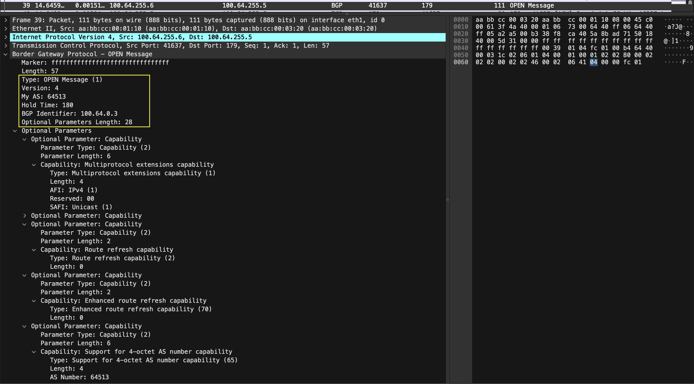
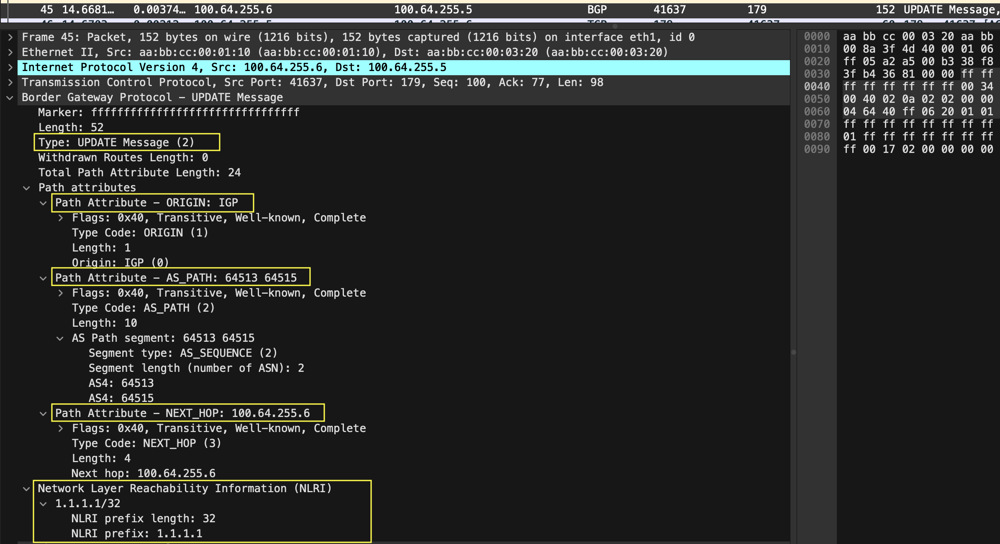
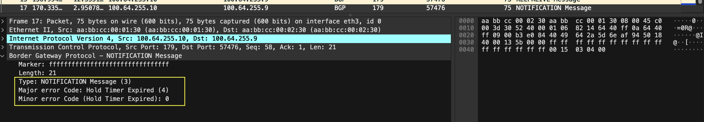
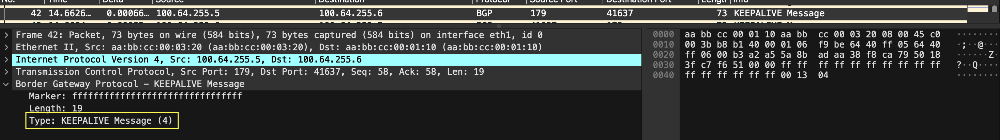
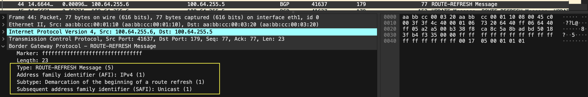

## BGP Message Types

> 💡 **TL;DR:** BGP has 5 message types: OPEN (session parameters and capabilities), KEEPALIVE (keeps the Hold Timer from expiring), UPDATE (routes), NOTIFICATION (errors, closes the session) and ROUTE-REFRESH (ask a peer to re-advertise, RFC 2918). All share a 19-byte header (Marker, Length, Type) and run over a single TCP port 179 session. RFC 4271 itself defines types 1–4.

---

### 1. Message Types Overview

| Message | Type code | Purpose |
|---|---:|---|
| **OPEN** | 1 | Negotiate version, ASN, Hold Time, Router ID and capabilities |
| **UPDATE** | 2 | Advertise new routes and withdraw old ones |
| **NOTIFICATION** | 3 | Report an error; the connection is closed right after |
| **KEEPALIVE** | 4 | Confirms the OPEN, then keeps the Hold Timer from expiring |
| **ROUTE-REFRESH** | 5 | Ask a peer to re-advertise its routes for an AFI/SAFI (RFC 2918) |

> 📝 **Note:** RFC 4271 only defines types 1–4 and mentions that RFC 2918 adds one more. Type 5 comes from RFC 2918 (updated by RFC 7313, Enhanced Route Refresh).

---

### 2. Common Header

Every BGP message starts with the same 19-byte header:

| Field | Size | Purpose |
|---|---|---|
| Marker | 16 bytes | Included for compatibility. **Must be all ones** |
| Length | 2 bytes | Total message length, header included (19–4096) |
| Type | 1 byte | Message type code (1–5) |

> ⚠️ **Gotcha:** A Marker that is not all ones is a "Connection Not Synchronized" error (Message Header Error). A bad Length is "Bad Message Length", and an unknown Type is "Bad Message Type".

---

### 3. OPEN Message

| Field | Size | Notes |
|---|---|---|
| Version | 1 byte | Current BGP version is 4 |
| My Autonomous System | 2 bytes | Sender's ASN. For a 4-byte ASN this holds AS_TRANS (23456); the real ASN travels in the 4-octet AS capability (RFC 6793) |
| Hold Time | 2 bytes | Proposed Hold Timer, in seconds |
| BGP Identifier | 4 bytes | Sender's Router ID |
| Optional Parameters Length | 1 byte | 0 means no optional parameters |
| Optional Parameters | Variable | Type-Length-Value triplets; capabilities are carried here |

- **Hold Time:** each side uses the **smaller** of its configured value and the received one. Valid values are **0 or at least 3 seconds**; an implementation must reject 1 or 2 seconds.
- **BGP Identifier:** an IP address assigned to the speaker, fixed at startup and the same for every interface and peer. The RFC does not say how to pick it, so selection is vendor behavior:

| Vendor | Default selection |
|---|---|
| Cisco | Manually configured ID; else highest loopback IP; else highest IP on an active physical interface |
| HPE Comware | Highest loopback IP; else highest physical IP regardless of interface status |
| Extreme SLX | Lowest loopback IP; else lowest physical IP |

> ⚠️ **Gotcha:** On Cisco, the ID is picked when the BGP process starts and is kept even if its source interface is removed, until the BGP process is cleared. Configure `bgp router-id` manually so it never changes unexpectedly.

---

### 4. UPDATE Message

| Field | Size | Notes |
|---|---|---|
| Withdrawn Routes Length | 2 bytes | 0 means no withdrawn routes |
| Withdrawn Routes | Variable | List of prefixes, each `<length in bits (1 byte), prefix>` |
| Total Path Attribute Length | 2 bytes | 0 means no path attributes and no NLRI |
| Path Attributes | Variable | Each is `<type, length, value>`; type = flags byte + type-code byte |
| NLRI | Variable | Prefixes in the same `<length, prefix>` format; the length is not encoded, it is calculated |

- One UPDATE carries **one set of path attributes**, shared by **all** prefixes in its NLRI.
- It can advertise, withdraw, or do both at once. A withdraw-only UPDATE has no path attributes or NLRI.
- An UPDATE with valid path attributes but no NLRI is valid.
- The same prefix should not appear in both Withdrawn Routes and NLRI.

> 📝 **Note:** Prefixes are padded with trailing bits to the next octet boundary, and the value of those bits is irrelevant.

---

### 5. NOTIFICATION Message

Fields: Error Code (1 byte), Error Subcode (1 byte), Data (variable).

| Error Code | Name |
|---:|---|
| 1 | Message Header Error |
| 2 | OPEN Message Error |
| 3 | UPDATE Message Error |
| 4 | Hold Timer Expired |
| 5 | Finite State Machine Error |
| 6 | Cease |

- The BGP connection is closed immediately after a NOTIFICATION is sent. On receipt, the FSM goes back to Idle.
- A NOTIFICATION cannot be sent to report an error in a received NOTIFICATION; the error is only logged.

> ⚠️ **Gotcha:** Cease is not always an error. It is used for administrative shutdown, when a maximum-prefix limit is reached, and when a connection collision is resolved.

---

### 6. KEEPALIVE Message

- Consists of the 19-byte header only.
- The first KEEPALIVE confirms an acceptable OPEN (OpenSent → OpenConfirm); after that, KEEPALIVEs are sent periodically.
- **BGP does not use TCP keepalives.** KEEPALIVE messages exist to stop the Hold Timer from expiring.
- Suggested interval is at most **one third of the Hold Time**, never more often than **once per second**, and **none** if the negotiated Hold Time is 0.
- If no KEEPALIVE, UPDATE or NOTIFICATION arrives within the Hold Time, the router sends a NOTIFICATION (Hold Timer Expired) and closes the session.
- Example: Hold Timer 180 s → KEEPALIVE every 60 s.

---

### 7. ROUTE-REFRESH Message (RFC 2918)

| Item | Detail |
|---|---|
| Type | 5 |
| Body | One AFI (2 bytes), Reserved (1 byte, sent as 0), SAFI (1 byte) |
| Capability | Route Refresh capability, code 2, length 0, advertised in OPEN |
| Sending rule | Only if the peer advertised the capability; the AFI/SAFI must be one the peer advertised at session setup |
| Receiver action | Re-advertises its **Adj-RIB-Out** for that AFI/SAFI, based on its **outbound policy** |

> ⚠️ **Gotcha:** The reply is not "the full routing table". The peer sends what its outbound policy would normally advertise for that AFI/SAFI.

**Cisco soft reset (vendor behavior):**
- `clear ip bgp <neighbor> soft in` sends a route refresh if the neighbor advertised the capability.
- If the neighbor does not support it, the router can use routes cached by `neighbor ... soft-reconfiguration inbound`. These are two separate mechanisms.
- Without either, a plain `clear ip bgp <neighbor> in` tears the session down (hard reset).
- Check capability support with `show ip bgp neighbors <ip>`, which shows "Route refresh: advertised and received".

---

### 8. CCIE-Depth: Sizes, Maths and Corner Cases

**Message size limits**

| Message | Minimum | Maximum |
|---|---:|---:|
| Any BGP message | 19 bytes | 4096 bytes |
| OPEN | 29 bytes | 4096 bytes |
| UPDATE | 23 bytes | 4096 bytes |
| NOTIFICATION | 21 bytes | 4096 bytes |
| KEEPALIVE | exactly 19 bytes | 19 bytes |

**NLRI length is not encoded:**
`NLRI length = message Length − 23 − Total Path Attribute Length − Withdrawn Routes Length`
(23 = 19-byte header + two 2-byte length fields)

**Worked example** (session without the 4-octet AS capability, so 2-byte ASNs in AS_PATH):
- One /24 prefix, e.g. 10.1.1.0/24 → length byte + 3 prefix bytes = **4 bytes** of NLRI.
- Path attributes: ORIGIN 4 + AS_PATH (one AS) 7 + NEXT_HOP 7 + MED 7 = **25 bytes**.
- Message Length = 19 + 2 + 2 + 25 + 4 = **52**. Check: 52 − 23 − 25 − 0 = 4 ✓

**Timer maths:** Hold Time negotiated = min(local, remote). Local 180 s and remote 90 s → 90 s, KEEPALIVE every 30 s.

**OPEN error subcodes (NOTIFICATION code 2):** 1 Unsupported Version Number, 2 Bad Peer AS, 3 Bad BGP Identifier, 4 Unsupported Optional Parameter, 6 Unacceptable Hold Time (subcode 5 is deprecated).

---

### 9. Quick Recap

| Topic | Remember |
|---|---|
| Type codes | 1 OPEN, 2 UPDATE, 3 NOTIFICATION, 4 KEEPALIVE, 5 ROUTE-REFRESH (RFC 2918) |
| Header | Marker 16 (all ones) + Length 2 + Type 1 = 19 bytes |
| Max message | 4096 bytes |
| My AS field | 2 bytes, so AS_TRANS 23456 + capability for 4-byte ASNs |
| Hold Time | 0 or ≥3 s; negotiated = the smaller value |
| KEEPALIVE | Header only; not a TCP keepalive; ≤ Hold ÷ 3, max once per second |
| NOTIFICATION | Always closes the session; code 6 (Cease) is not always an error |
| ROUTE-REFRESH | Needs capability 2; peer re-sends Adj-RIB-Out per outbound policy |
| Router ID | Vendor-dependent selection; configure it manually |

---

### References

**Standards**
- [RFC 4271 — A Border Gateway Protocol 4 (BGP-4)](https://www.rfc-editor.org/rfc/rfc4271.html) (4 message formats, 6 error handling)
- [RFC 2918 — Route Refresh Capability for BGP-4](https://www.rfc-editor.org/rfc/rfc2918.html)
- [RFC 7313 — Enhanced Route Refresh Capability for BGP-4](https://datatracker.ietf.org/doc/rfc7313/)
- [RFC 6793 — BGP Support for Four-Octet AS Number Space](https://datatracker.ietf.org/doc/rfc6793)

**Vendor documentation**
- [Cisco — BGP Router ID selection](https://www.cisco.com/c/en/us/support/docs/ip/border-gateway-protocol-bgp/13753-25.html)
- [Cisco — BGP Soft Reset Enhancement (route refresh)](https://www3-realm.cisco.com/en/US/products/ps6599/products_data_sheet09186a0080087b3a.html)