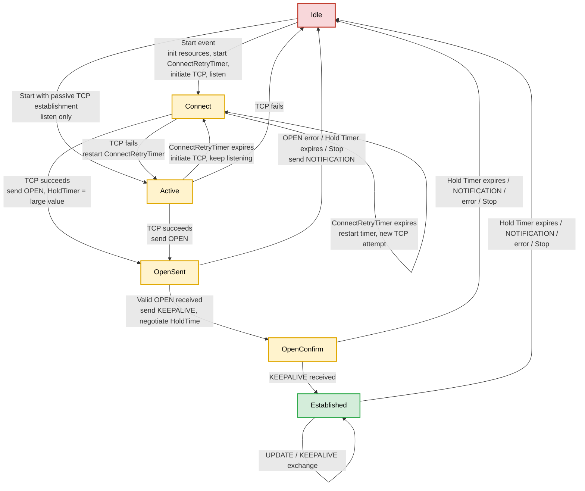

## ASN & BGP Neighbor States (FSM)

> 💡 **TL;DR:** ASNs were originally 2-byte (16-bit) numbers and were extended to 4-byte (32-bit) numbers through RFC 6793 to address ASN exhaustion.
>
> BGP neighbor establishment follows six FSM states: Idle → Connect → Active → OpenSent → OpenConfirm → Established.
>
> Connect and Active are TCP connection establishment states. Their transitions depend on TCP events and retry timers. Protocol errors and session failures can trigger transitions back to Idle.

---

### 1. Autonomous System Numbers (ASN)

| ASN range | Size | Purpose | Defined in |
|---|---|---|---|
| 0 | 16-bit | Reserved | IANA special-purpose registry |
| 1 – 23455 | 16-bit | Public (assigned via RIRs) | IANA AS registry |
| **23456** | 16-bit | **AS_TRANS** (placeholder for 4-byte ASNs) | RFC 6793 |
| 23457 – 64495 | 16-bit | Public (assigned via RIRs) | IANA AS registry |
| 64496 – 64511 | 16-bit | Documentation / sample code | RFC 5398 |
| 64512 – 65534 | 16-bit | **Private use** (1023 ASNs) | RFC 6996 |
| 65535 | 16-bit | Reserved | RFC 7300 |
| 65536 – 65551 | 32-bit | Documentation / sample code | RFC 5398 |
| 65552 – 131071 | 32-bit | Reserved | IANA AS registry |
| 131072 – 4199999999 | 32-bit | Public | IANA AS registry |
| 4200000000 – 4294967294 | 32-bit | **Private use** (94,967,295 ASNs) | RFC 6996 |
| 4294967295 | 32-bit | Reserved | RFC 7300 |

> ⚠️ **Gotcha:** The old rule of thumb "public 1–64511 / private 64512–65535" is wrong in three ways: 23456 is reserved, 64496–64511 is documentation, and 65535 is reserved (the private block ends at 65534). It also ignores the 4-byte private block.

---

### 2. ASN Notation (RFC 5396)

| Notation | Format | Example (ASN 196613) |
|---|---|---|
| **asplain** | Single decimal number | `196613` |
| **asdot+** | Always `high.low` | `3.5` |
| **asdot** | Plain decimal below 65536, `high.low` from 65536 up | `3.5` (but `64512` stays `64512`) |

Conversion: `asplain = high × 65536 + low`

- `65536` → `1.0`
- `196613` → 196613 ÷ 65536 = 3 remainder 5 → `3.5`
- `4200000000` (first 4-byte private) → `64086.59904`
- `4294967294` (last 4-byte private) → `65535.65534`

---

### 3. 4-Byte ASN on the Wire (RFC 6793)

| Where | What happens |
|---|---|
| OPEN "My Autonomous System" field | Still **2 octets**. A speaker without a 2-byte ASN puts **23456 (AS_TRANS)** here |
| OPEN capability | New "four-octet AS number" capability carries the **real 4-byte ASN** |
| NEW ↔ NEW speakers | Use the ASN from the capability, ignore the "My AS" field |
| NEW ↔ OLD speakers | The old router sees its peer as AS 23456; real path info travels in **AS4_PATH** (attribute type 17) and **AS4_AGGREGATOR** |

RFC 6793 **obsoletes RFC 4893** and updates RFC 4271.

> ⚠️ **Gotcha:** When peering with an old 2-byte-only router, the old side must be configured with remote-as **23456**, because that is the ASN it sees in your OPEN message.

---

### 4. BGP Neighbor States

| State | What BGP is doing |
|---|---|
| **Idle** | Initial state. Refuses all incoming BGP connections. Waits for a Start event |
| **Connect** | Waiting for the TCP connection to complete (outgoing attempt in progress) |
| **Active** | Trying to acquire a peer by **listening for and accepting** a TCP connection |
| **OpenSent** | TCP is up, OPEN sent, waiting for the peer's OPEN |
| **OpenConfirm** | OPENs exchanged, waiting for a KEEPALIVE |
| **Established** | Peering is up; UPDATE, KEEPALIVE and NOTIFICATION messages are exchanged |

> ⚠️ **Gotcha — Active is not "actively initiating":** The TCP attempt is started on the way **into Connect**. In Active, the router listens, and when the ConnectRetryTimer expires it goes back to Connect and tries again. A session flapping between Connect and Active usually means a TCP transport problem (no route, ACL, wrong source address, peer not configured).

> ⚠️ **Gotcha — real devices deviate from the RFC:** vendor state names and transitions don't always map 1:1 to RFC 4271, so use the RFC as the reference model and verify behavior with debugs on the actual platform.

---

### 5. FSM Diagram



> 📝 This shows the principal transitions only. RFC 4271 defines **28 events**; only ManualStart (1) and ManualStop (2) are mandatory administrative events, and the rest depend on optional session attributes.

---

### 6. Timers That Drive the FSM

| Timer | Role |
|---|---|
| **ConnectRetryTimer** | Mandatory. Drives the Connect ↔ Active retry loop |
| **HoldTimer** | Set to a large value in OpenSent, then to the negotiated value. If no KEEPALIVE, UPDATE or NOTIFICATION arrives in time → NOTIFICATION (Hold Timer Expired) and Idle |
| **KeepaliveTimer** | Controls when KEEPALIVEs are sent |
| **DelayOpenTimer** *(optional)* | Delays sending OPEN so the peer can send its OPEN first |
| **IdleHoldTimer** *(optional)* | Holds a peer in Idle after repeated flaps (peer-oscillation damping) |

---

### 7. CCIE-Depth: Maths, Corner Cases, Interactions

**Hold time and keepalive maths**
- Negotiated HoldTime = **smaller** of the two configured values.
- KEEPALIVE interval is at most **one third** of the Hold Time, and never more often than once per second.
- Negotiated Hold Time of **0** → no periodic KEEPALIVEs at all.
- Example: local 180 s, remote 90 s → negotiated 90 s, KEEPALIVE every 30 s.

> ⚠️ **Gotcha:** A Hold Time must be 0 or at least 3 seconds. An implementation **must reject** 1 or 2 seconds (OPEN error, subcode "Unacceptable Hold Time").

**Connection collision (both sides connect at once)**
- Two parallel TCP connections can form between the same pair of speakers.
- Rule: compare BGP Identifiers as 4-octet unsigned integers and keep the connection **initiated by the speaker with the higher BGP Identifier**. The loser is closed with a NOTIFICATION (Cease).
- Collision **cannot be detected** while connections are in Idle, Connect or Active; the check happens on receipt of an OPEN, against connections in OpenConfirm.
- A collision with an existing **Established** session closes the **new** connection, unless configured otherwise.

**Peer-oscillation damping (optional)**
- With damping enabled, IdleHoldTime grows when a peer keeps flapping. The RFC's example: 10 connect/disconnect cycles within 5 minutes raise IdleHoldTime from 0 to 120 s.

**Interactions to remember**
- NOTIFICATION error codes tied to the FSM: **4** Hold Timer Expired, **5** Finite State Machine Error, **6** Cease.
- A NOTIFICATION always closes the connection, so the next state is always Idle.
- Passive-mode peers (listen only) go Idle → **Active** directly, skipping Connect.
- 4-byte ASNs change nothing in the FSM; the ASN compatibility is negotiated inside the OPEN/capability exchange (section 3).

---

### 8. Quick Recap

| Topic | Remember |
|---|---|
| Private ASNs | 64512–65534 and 4200000000–4294967294 |
| Reserved ASNs | 0, 23456 (AS_TRANS), 65535, 4294967295 |
| Documentation ASNs | 64496–64511 and 65536–65551 |
| ASN size | 32 bits; "My AS" field in OPEN is 2 octets, so AS_TRANS + capability |
| Connect | Waiting for TCP to complete |
| Active | Listening / accepting; retries via timer → Connect |
| Connect → Active trigger | TCP **failure**, not timer expiry |
| ConnectRetryTimer expiry | Connect stays in Connect; Active goes to Connect |
| All failures | Back to Idle (no "Closing" state) |
| Hold / Keepalive | Hold = min(local, remote); Keepalive ≤ Hold ÷ 3 |

---

### References

**Standards**
- [RFC 4271 — A Border Gateway Protocol 4 (BGP-4)](https://www.rfc-editor.org/rfc/rfc4271.html) (§4.2 OPEN, §6 errors, §6.8 collision, §8 FSM)
- [RFC 6793 — BGP Support for Four-Octet AS Number Space](https://datatracker.ietf.org/doc/rfc6793) (obsoletes RFC 4893)
- [RFC 5396 — Textual Representation of AS Numbers](https://datatracker.ietf.org/doc/html/rfc5396)
- [RFC 5398 — AS Number Reservation for Documentation Use](https://datatracker.ietf.org/doc/html/rfc5398)
- [RFC 6996 — AS Reservation for Private Use](https://www.rfc-editor.org/rfc/rfc6996)
- [IANA — Autonomous System (AS) Numbers](https://www.iana.org/assignments/as-numbers/as-numbers.xhtml)
- [IANA — Special-Purpose AS Numbers](https://www.iana.org/assignments/iana-as-numbers-special-registry/iana-as-numbers-special-registry.xhtml)

**Vendor documentation**
- [Fortinet — BGP Neighbor Adjacency States](https://community.fortinet.com/t5/FortiGate/Technical-Tip-BGP-Neighbor-Adjacency-States/ta-p/208989)
- [Nokia 7750 SR — BGP Session States](https://infocenter.nokia.com/public/7750SR222R1A/topic/com.nokia.Unicast_Guide/bgp_session_sta-ai9exj5yii.html)

#### Sample Router Output

```log
ce# show ip bgp summary 
              
BGP router identifier 100.64.255.5, local AS number 64514
BGP table version is 3, main routing table version 3
2 network entries using 496 bytes of memory
3 path entries using 408 bytes of memory
3/2 BGP path/bestpath attribute entries using 888 bytes of memory
2 BGP AS-PATH entries using 80 bytes of memory
0 BGP route-map cache entries using 0 bytes of memory
0 BGP filter-list cache entries using 0 bytes of memory
BGP using 1872 total bytes of memory
BGP activity 2/0 prefixes, 3/0 paths, scan interval 60 secs
2 networks peaked at 23:02:59 Jun 20 2026 IST (00:00:08.823 ago)

Neighbor        V           AS MsgRcvd MsgSent   TblVer  InQ OutQ Up/Down  State/PfxRcd
100.64.255.2    4        64512       6       5        3    0    0 00:01:04        1
100.64.255.6    4        64513       5       5        3    0    0 00:01:06        1
```

```log
ce#show ip bgp neighbors 100.64.255.2

BGP neighbor is 100.64.255.2,  remote AS 64512, external link
  BGP version 4, remote router ID 100.64.0.2
  BGP state = Established, up for 00:01:08  <<<<<<< BGP state
  Last read 00:00:09, last write 00:00:09, hold time is 180, keepalive interval is 60 seconds   <<<<< Timers
  Last update received: 00:00:09
  Neighbor sessions:
    1 active, is not multisession capable (disabled)
  Neighbor capabilities:
    Route refresh: advertised and received(new)
    Four-octets ASN Capability: advertised and received
    Address family IPv4 Unicast: advertised and received
    Enhanced Refresh Capability: advertised and received
    Multisession Capability: 
    Stateful switchover support enabled: NO for session 1
  Message statistics:
    InQ depth is 0
    OutQ depth is 0
    
                         Sent       Rcvd
    Opens:                  1          1
    Notifications:          0          0
    Updates:                2          3
    Keepalives:             2          2
    Route Refresh:          0          0
    Total:                  5          6
  Do log neighbor state changes (via global configuration)
  Default minimum time between advertisement runs is 30 seconds

 For address family: IPv4 Unicast
  Session: 100.64.255.2
  BGP table version 3, neighbor version 3/0
  Output queue size : 0
  Index 1, Advertise bit 0
  1 update-group member
  Outbound path policy configured
  Route map for outgoing advertisements is 1
  Slow-peer detection is disabled
  Slow-peer split-update-group dynamic is disabled
                                 Sent       Rcvd
  Prefix activity:               ----       ----
    Prefixes Current:               1          1 (Consumes 136 bytes)
    Prefixes Total:                 1          1
    Implicit Withdraw:              0          0
    Explicit Withdraw:              0          0
    Used as bestpath:             n/a          0
    Used as multipath:            n/a          0
    Used as secondary:            n/a          0

                                   Outbound    Inbound
  Local Policy Denied Prefixes:    --------    -------
    AS_PATH loop:                       n/a          1
    Other Policies:                       1        n/a
    Total:                                1          1
  Number of NLRIs in the update sent: max 1, min 0
  Current session network count peaked at 1 entries at 23:03:01 Jun 20 2026 IST (00:00:10.119 ago)
  Highest network count observed at 1 entries at 23:03:01 Jun 20 2026 IST (00:00:10.119 ago)
  Last detected as dynamic slow peer: never
  Dynamic slow peer recovered: never
  Refresh Epoch: 1
  Last Sent Refresh Start-of-rib: never
  Last Sent Refresh End-of-rib: never
  Last Received Refresh Start-of-rib: never
  Last Received Refresh End-of-rib: never
                                       Sent       Rcvd
        Refresh activity:              ----       ----
          Refresh Start-of-RIB          0          0
          Refresh End-of-RIB            0          0

  Address tracking is enabled, the RIB does have a route to 100.64.255.2
  Route to peer address reachability Up: 1; Down: 0
    Last notification 00:01:18
  Connections established 1; dropped 0
  Last reset never
  External BGP neighbor configured for connected checks (single-hop no-disable-connected-check)
  Interface associated: Ethernet0/1 (peering address in same link)
  Transport(tcp) path-mtu-discovery is enabled  <<<< PMTUD enabled
  Graceful-Restart is disabled
  SSO is disabled
Connection state is ESTAB, I/O status: 1, unread input bytes: 0            
Connection is ECN Disabled, Mininum incoming TTL 0, Outgoing TTL 1  <<<< As it is a eBGP by default TTL is 1
Local host: 100.64.255.1, Local port: 63020
Foreign host: 100.64.255.2, Foreign port: 179  <<<< BGP server selection
Connection tableid (VRF): 0
Maximum output segment queue size: 50

Enqueued packets for retransmit: 0, input: 0  mis-ordered: 0 (0 bytes)

Event Timers (current time is 0x14C31):
Timer          Starts    Wakeups            Next
Retrans             4          0             0x0
TimeWait            0          0             0x0
AckHold             4          2             0x0
SendWnd             0          0             0x0
KeepAlive           0          0             0x0
GiveUp              0          0             0x0
PmtuAger            1          0         0x969DA
DeadWait            0          0             0x0
Linger              0          0             0x0
ProcessQ            0          0             0x0

iss:   20273499  snduna:   20273672  sndnxt:   20273672
irs: 2417306069  rcvnxt: 2417306291

sndwnd:  16212  scale:      0  maxrcvwnd:  16384
rcvwnd:  16163  scale:      0  delrcvwnd:    221

SRTT: 413 ms, RTTO: 3205 ms, RTV: 2792 ms, KRTT: 0 ms
minRTT: 4 ms, maxRTT: 1000 ms, ACK hold: 120 ms
uptime: 68125 ms, Sent idletime: 9238 ms, Receive idletime: 9359 ms 
Status Flags: active open
Option Flags: nagle, path mtu capable, SACK option permitted    <<< PMTU enable
  win-scale
IP Precedence value : 6
Window update Optimisation : Enabled
ACK Optimisation : Dynamic ACK Tuning Enabled

Datagrams (max data segment is 1460 bytes):
Peer MSS:       1460
Rcvd: 8 (out of order: 0), with data: 4, total data bytes: 221
Sent: 9 (retransmit: 0, fastretransmit: 0, partialack: 0, Second Congestion: 0), with data: 4, total data bytes: 172

 Packets received in fast path: 0, fast processed: 0, slow path: 0
 fast lock acquisition failures: 0, slow path: 0
TCP Semaphore      0x7FFFDCEA4AF0  FREE 
```
